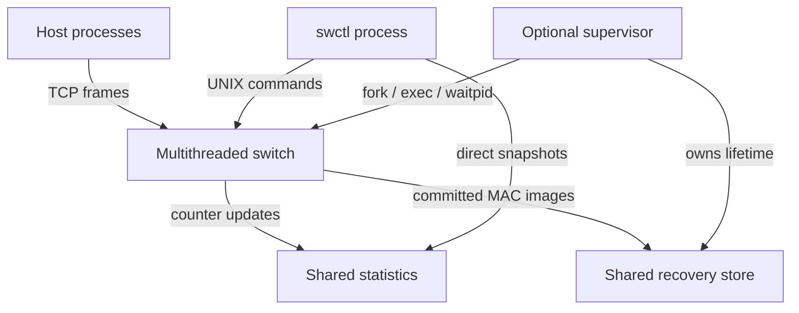
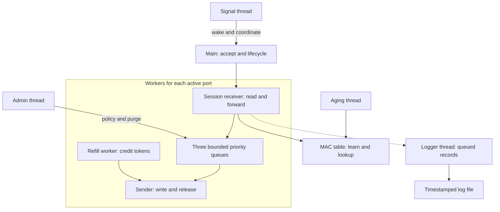

# Virtual Switch

A multithreaded user-space Layer 2 switch written in C11 for an Operating Systems project. TCP clients represent hosts; a separate `swctl` process provides management through a UNIX socket and shared-memory statistics.

The implementation includes the core switch, advanced scheduling and administration, two switches linked by anonymous pipes, crash recovery under a supervisor, and a reproducible lock benchmark.

## Architecture





The main thread accepts; there is no extra accept worker. Each port session runs
its receiver and owns a sender plus refill worker. Admin, signal, MAC-aging and
logger workers are shared. The sender writes outside queue/MAC/ports locks,
while holding its per-port transmit lock. 

Linux, GCC, GNU Make, Bash and Python 3 are required. The C programs use libc/POSIX APIs, `-pthread` and `-lrt`. Valgrind is used for memory checks and GCC ThreadSanitizer for race checks. Matplotlib is required only when regenerating benchmark graphs. The bundled
three-page PDF needs no build dependency; regenerating it uses ReportLab and
DejaVu Sans fonts (`python3 tools/build_report.py`). Editing/rendering the
companion DOT diagram uses Graphviz.

All shell commands below run from the repository root.

## Build

```bash
make -j4           # programs, C checks/demos, fixtures and course-flags benchmark
make tests         # all C checks plus manual demos and recovery fixture
make unit-check    # automated C unit/function checks
make check         # unit + network/host/signal/bonus integration checks
make audit         # unchecked standalone-call regression guard
make clean         # generated programs/build tree only; preserves measured results
```

The default build uses `gcc -std=c11 -Wall -Wextra -Werror -g -O0`, plus `-pthread`,
`-Iinc` and `-lrt`. Native performance measurements use the separate optimized
`build/lock_bench_release` target. All programs are built from the listed C sources;
Bash/Python test drivers run against those executables.

```bash
make tsan
setarch "$(uname -m)" -R make tsan-check
make valgrind-check
```

Use `setarch -R` only if this machine needs the TSan mapping workaround. Never run
Valgrind on a TSan executable. Integration targets use default-instance resources
and run their recipes sequentially; do not run two integration targets concurrently.

## Quick start

In terminal 1:

```bash
./switch 9000 3
```

Arguments are `<tcp_port> <num_ports>`: TCP port 1–65535 and 1–64 logical ports. A quiet terminal is normal; runtime events go to `switch.log`. Stop with Ctrl+C.

In terminal 2:

```bash
./swctl show ports
./swctl show mac
./swctl stats
./swctl stats --watch
```

Your host sends and receives over the required interface:

```bash
./host 127.0.0.1 9000 02:00:00:00:00:01
```

It prints `CONNECTED`, receives asynchronously while accepting commands, and
prints `FRAME ... length=N text=...` for each complete incoming frame. Commands:

```text
send ff:ff:ff:ff:ff:ff 1 hello everyone
sendp 02:00:00:00:00:02 1 0 high priority message
recv 1
quit
```

`send DST VLAN TEXT` uses normal priority. `sendp DST VLAN PRIORITY TEXT` chooses
0/1/2. Payloads are text up to 1500 bytes, including spaces; an omitted payload is
empty. Received binary/control bytes are escaped as `\xHH`. `recv N` exits after
N total received frames (including any already displayed), so a piped receive test
cannot miss a frame that arrives just before its command is parsed. Without a
`recv` target, stdin EOF ends the host. SIGINT/SIGTERM closes it cleanly.

For example, start the receiver first in a separate terminal:

```bash
printf 'recv 1\n' | ./host 127.0.0.1 9000 02:00:00:00:00:02
```

Then send from another terminal:

```bash
printf 'send 02:00:00:00:00:02 1 hello\n' | ./host 127.0.0.1 9000 02:00:00:00:00:01
```

For an automated example that starts/stops its own switch:

```bash
bash tests/basic_forward.sh
```

## Administration

User-facing port numbers are one-based. The internal table uses zero-based slots.

| Command                   | Behavior                                                                   |
| ------------------------- | -------------------------------------------------------------------------- |
| `./swctl show ports`    | State, VLAN, access/trunk/sniffer mode and mirror destination              |
| `./swctl show mac`      | MAC, logical port and VLAN                                                 |
| `./swctl clear mac`     | Clear the table; supervised mode commits before success reply              |
| `./swctl shutdown 2`    | Disable slot 2, cancel I/O, discard queued references and join its session |
| `./swctl up 2`          | Enable admission to slot 2; the old TCP client must reconnect              |
| `./swctl vlan 2 20`     | Make slot 2 an access port in VLAN 20                                      |
| `./swctl trunk 4`       | Select slot 4 as the sole trunk                                            |
| `./swctl trunk 0`       | Disable the configurable trunk                                             |
| `./swctl mirror 1 3`    | Mirror accepted ingress from slot 1 to dedicated sniffer slot 3            |
| `./swctl mirror 1 0`    | Disable mirroring from slot 1                                              |
| `./swctl stats`         | Snapshot counters directly from shared memory                              |
| `./swctl stats --watch` | Refresh the shared-memory counters every second; Ctrl+C stops watch        |

An access port must send frames with its assigned VLAN. The trunk preserves the VLAN field. A sniffer can intentionally observe mirrored traffic across VLANs, is excluded from ordinary forwarding, and cannot inject ordinary traffic. Mirroring covers accepted ingress and frames accepted into the monitored port's egress queue. A shared sniffer gets one copy per frame even if both endpoints
are monitored; a mirror copy is never mirrored recursively. Egress capture is
queue acceptance, not a claim that a later socket write succeeded.

## Configuration and signals

The reload configuration is **one integer**, not `key=value` settings. `SIGHUP` changes MAC aging only. Startup uses the compiled default until reload.

```bash
printf '30\n' > vswitch.conf
kill -HUP <actual-switch-pid>
kill -USR1 <actual-switch-pid>
kill -INT <actual-switch-pid>
```

Replace the angle-bracket placeholder with one actual PID. SIGUSR1 writes `mac_dump.txt`; SIGINT requests coordinated shutdown. Do not target every process named `switch` when running multiple instances.

| Default                               |                              Value |
| ------------------------------------- | ---------------------------------: |
| MAC age / sweep interval              |                          5 s / 1 s |
| MAC buckets / table capacity          |                           16 / 256 |
| Validated MAC/VLAN keys per port      |                                  4 |
| Admission timeout                     |                                2 s |
| Priority values                       |            0 high, 1 normal, 2 low |
| Queue capacity                        |        8 per priority, 24 per port |
| Weighted schedule / overdue threshold |                     5:3:1 / 100 ms |
| Rate / initial burst                  |          1000 frames/s / 10 tokens |
| Refill cadence                        |                approximately 10 ms |
| Logger capacity / message storage     | 64 records / 256 bytes per message |

Queue-aging fairness requires the port's sender to make progress. The token bucket permits a burst; it is not a strict fixed-window counter.

Instance environment options must be set before workers start:

| Environment            | Default/purpose                                                       |
| ---------------------- | --------------------------------------------------------------------- |
| `VSWITCH_SOCKET`     | `/tmp/vswitch.sock`; also used by `swctl`                         |
| `VSWITCH_STATS`      | `/vswitch_stats`; also used by statistics commands                  |
| `SWITCH_LOG_PATH`    | `switch.log`                                                        |
| `SWITCH_DUMP_PATH`   | `mac_dump.txt`                                                      |
| `SWITCH_CONFIG_PATH` | `vswitch.conf`                                                      |
| `VSWITCH_MAC_STORE`  | Optional supervisor-owned recovery object; normally set by supervisor |

`VSWITCH_NAME` alone does not configure the switch; shell tests may derive the two actual IPC settings from their own test identifier.

## Wire protocol

The header is 17 bytes followed by `length` payload bytes.

| Byte offset | Field           | Bytes | Valid values                 |
| ----------: | --------------- | ----: | ---------------------------- |
|           0 | length          |     2 | 0–1500; payload length only |
|           2 | source MAC      |     6 | Six address bytes            |
|           8 | destination MAC |     6 | Six address bytes            |
|          14 | VLAN            |     2 | 1–4094                      |
|          16 | priority        |     1 | 0–2                         |

Length and VLAN are network byte order. Python tests use `struct.pack("!H6s6sHB", ...)`. TCP and pipes are byte streams; one read/write is not assumed to transfer a complete frame. See `frame.c`, `io.c`, `frame_io.c` and `pipe_link.c`.

## Bonus: two switches

```bash
./build/two_switches 9200 9201 3
```

Each process has two host slots and a reserved pipe trunk at port 3. Exactly two inter-process data pipes carry both directions; each process also has local wake pipes for cancellation. Fork/exec occurs before switch workers start.

The launcher prints distinct admin and statistics names. Use those actual values, for example:

```bash
VSWITCH_SOCKET=/tmp/vswitch-12345-a.sock ./swctl show mac
VSWITCH_STATS=/vswitch_12345_a_stats ./swctl stats
```

`12345` is an example launcher PID. The physical pipe trunk is fixed for that launch and cannot be disabled, reassigned or used as a mirror source. Ctrl+C to the launcher stops/reaps both switches. See [two-switch details](bonus/two_switches/README.md).

## Bonus: supervisor and MAC recovery

```bash
./build/switch_supervisor ./switch 9300 3
```

The parent retains a shared MAC recovery image, restarts abnormal worker exits and gives replacements the same object name. The default limit is five replacements, with 250 ms backoff and a five-second graceful-stop deadline. The supervisor prints the per-instance socket/statistics names. SIGINT/SIGTERM stops it; SIGHUP/SIGUSR1 forwards to its active worker.

Committed MAC/VLAN, slot, aging timestamp and LRU data survive a worker crash. TCP sessions and administrative policy do not. Recovered mappings are visible but treated as unknown destinations until source relearning validates them; this prevents stale known-unicast selection after slot reuse. Shared memory survives worker crashes while the parent lives, not machine power loss.

The supervisor manages a standalone switch. It is not combined with the two-switch pipe launcher. See [live recovery](bonus/supervisor/LIVE_RECOVERY.md).

## Bonus: benchmark

```bash
make build/lock_bench
python3 bonus/benchmark/check_benchmark.py
make benchmark
```

`make benchmark` builds a separate -O2 executable and records its actual compiler
command while generating results. It does not change the default course build.

Keep `results/benchmark/` tracked: `raw.csv`, `summary.csv`, `metadata.json`, `throughput.png`, `throughput.pdf` and `report.md`. The graph/report contain native target-machine measurements. This is a table-operation microbenchmark, not whole-switch packet throughput. It excludes lookup-side LRU mutation and the supervised checkpoint path. See [benchmark scope](bonus/benchmark/README.md).

## Verification

Do not leave a manual default-instance switch running when executing integration tests that use its default IPC names. Run those tests sequentially. Random TCP ports reduce but do not eliminate collisions.

```bash
bash tests/basic_forward.sh
TIER1_PORT=9400 python3 tests/tier1_verify.py \
    valgrind --leak-check=full --show-leak-kinds=all \
    --errors-for-leak-kinds=all --error-exitcode=99 ./switch
VLAN_TEST_PORT=9410 python3 tests/vlan_integration.py
MIRROR_TEST_PORT=9420 python3 tests/mirror_integration.py
PORT_ADMIN_TEST_PORT=9430 python3 tests/port_admin_integration.py
LOGGER_TEST_PORT=9440 python3 tests/logger_integration.py
TWO_SWITCH_TEST_PORT=9450 python3 tests/two_switch_integration.py
```

Recovery tests use a separate fixture binary with a 60-second MAC age and one-MAC active limit:

```bash
./build/mac_recovery_check
PORT=9300 bash tests/supervisor_recovery.sh
```

Separate ordinary TSan build:

```bash
gcc -std=c11 -Wall -Wextra -Werror -g -O0 -Iinc -pthread \
    -fsanitize=thread src/switch.c src/mac_store.c src/pipe_link.c \
    src/async_logger.c src/rate_limit.c src/signal_control.c src/control.c \
    src/frame_queue.c src/shared_frame.c src/frame_io.c src/frame.c \
    src/io.c src/mac_table.c src/shm_stats.c -lrt -o build/switch_tsan
setarch "$(uname -m)" -R env TSAN_OPTIONS=halt_on_error=1 \
    SWITCH="$PWD/build/switch_tsan" bash tests/basic_forward.sh
```

ASLR disabling is the workaround used for this machine's TSan mapping issue. It is not a requirement of switch operation. Never combine Valgrind with a TSan executable. Recovery-specific TSan commands are in `bonus/supervisor/LIVE_RECOVERY.md`.

## Directory structure

The maintained layout is shown below; `build/` is generated and benchmark results
come from the development machine. Older local delivery archives/backups are not
part of the maintained source tree.

```text
Virtual-Switch/
├── Makefile
├── README.md
├── .gitignore
├── inc/
│   ├── async_logger.h
│   ├── checked.h
│   ├── control.h
│   ├── frame.h
│   ├── frame_io.h
│   ├── frame_queue.h
│   ├── io.h
│   ├── mac_store.h
│   ├── mac_table.h
│   ├── pipe_link.h
│   ├── rate_limit.h
│   ├── shared_frame.h
│   ├── shm_stats.h
│   └── signal_control.h
├── src/
│   ├── async_logger.c
│   ├── control.c
│   ├── frame.c
│   ├── frame_io.c
│   ├── frame_queue.c
│   ├── host.c
│   ├── io.c
│   ├── mac_store.c
│   ├── mac_table.c
│   ├── pipe_link.c
│   ├── rate_limit.c
│   ├── shared_frame.c
│   ├── shm_stats.c
│   ├── signal_control.c
│   ├── swctl.c
│   └── switch.c
├── tests/
│   ├── basic_forward.sh
│   ├── host_check.py
│   ├── logger_check.c
│   ├── logger_integration.py
│   ├── mac_admin_check.c
│   ├── mac_aging_count_check.c
│   ├── mac_log_check.c
│   ├── mac_recovery_check.c
│   ├── mac_store_check.c
│   ├── mac_vlan_check.c
│   ├── main.c
│   ├── mirror_forward_check.c
│   ├── mirror_integration.py
│   ├── pipe_link_check.c
│   ├── port_admin_check.c
│   ├── port_admin_integration.py
│   ├── qos_check.c
│   ├── rate_limit_check.c
│   ├── shm_stats_check.c
│   ├── signal_check.py
│   ├── signal_control_check.c
│   ├── stats_demo.c
│   ├── stats_instance_check.c
│   ├── supervisor_check.py
│   ├── supervisor_integration.py
│   ├── supervisor_probe.c
│   ├── supervisor_recovery.sh
│   ├── tier1_verify.py
│   ├── two_switch_integration.py
│   ├── two_switch_launcher_check.py
│   ├── two_switch_pipe_check.c
│   ├── vlan_forward_check.c
│   └── vlan_integration.py
├── bonus/
│   ├── benchmark/
│   │   ├── README.md
│   │   ├── check_benchmark.py
│   │   ├── lock_bench.c
│   │   └── run_benchmark.py
│   ├── supervisor/
│   │   ├── LIVE_RECOVERY.md
│   │   ├── MAC_STORE.md
│   │   ├── README.md
│   │   ├── build_recovery.sh
│   │   ├── build_store.sh
│   │   ├── build_supervisor.sh
│   │   └── switch_supervisor.c
│   └── two_switches/
│       ├── README.md
│       ├── build.sh
│       └── two_switches.c
├── docs/
│   ├── diagrams/
│   │   ├── threads.dot
│   │   ├── threads.png
│   │   └── threads.svg
│   ├── REPORT.md
│   ├── SUBMISSION_REPORT.pdf
│   └── VERIFICATION.md
├── tools/
│   ├── audit_returns.py
│   └── build_report.py
├── results/benchmark/  # measured on the development machine
│   ├── raw.csv
│   ├── summary.csv
│   ├── metadata.json
│   ├── report.md
│   ├── throughput.png
│   └── throughput.pdf
└── build/              #  ignored by Git
```

## Limitations

There is no Ethernet NIC/TAP integration, spanning-tree protocol or authenticated TCP host identity. Reload changes MAC age only. The global ports lock and MAC capacity operations can serialize work; supervised whole-image checkpoints add further synchronization/copy cost. Mirror capture covers accepted ingress and queued egress. Logger contention can drop records by design, counted separately from submission errors. Counter values describe their implemented events, not guaranteed end-to-end delivery.

Some administrative operations serialize with admission, which can be waiting up to its timeout. Some VLAN/mirror changes wait for affected senders' transmit locks; TCP writes have a timeout, while the fixed pipe trunk is excluded from incompatible reconfiguration. These bounds and restrictions are part of the implementation, not claims of zero-latency administration.
