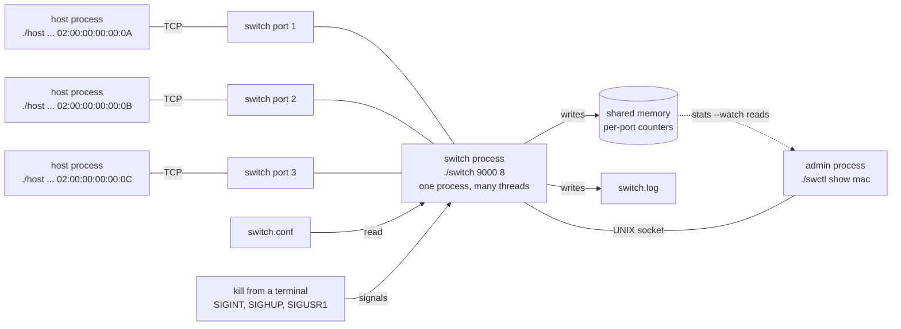
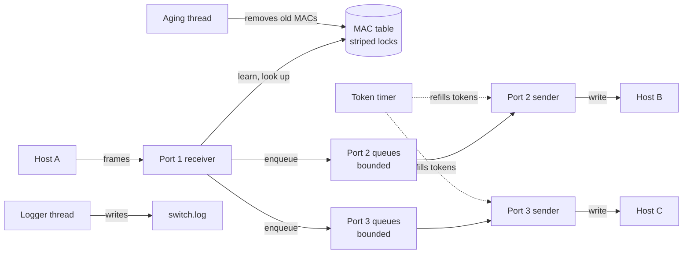

# Virtual Switch

A multithreaded software network switch written in C for the Operating Systems course (Fall 2026).

## Introduction

Virtual Switch is a user-space simulation of a layer-2 Ethernet switch. Each TCP client connects to one logical switch port and sends frames in a fixed format. The switch learns which host sits on which port, forwards each frame only where it needs to go, and handles the concurrency problems a real switch faces: many ports at once, slow or misbehaving hosts, shared frames, and live reconfiguration.

**Motivation.** Real switches are built around hardware, but their core logic (learning, forwarding, flooding, and queueing) is also a strong systems programming exercise. The project combines processes, threads, mutexes, condition variables, semaphores, sockets, signals, and shared memory in one codebase. It builds on Labs 02 to 08.

## Project Overview

The switch is one server process with many threads. Each port has its own receiver thread, bounded output queues, and sender thread. The receiver reads complete frames, learns the source MAC, and decides which ports should get the frame. Each output port's sender writes to its own host, so a slow host does not delay the others.

Core behaviour:

1. **Learn:** the source MAC of each incoming frame is recorded against the port it arrived on.
2. **Forward:** a unicast to a known MAC goes only to that port.
3. **Flood:** a broadcast (`FF:FF:FF:FF:FF:FF`) or a frame to an unknown MAC goes to every port except the one it came from, within the same VLAN.
4. **Drop, don't block:** when a port's queue is full, the frame is dropped for that port and counted. The receiver never waits on a full queue.
5. **Administer:** a separate `swctl` process changes port state, VLANs, and the MAC table while traffic is flowing.

## Key Features

| Feature                    | Description                                                                                 |
| -------------------------- | ------------------------------------------------------------------------------------------- |
| Wire format                | Fixed 17-byte header with network-byte-order fields, followed by 0 to 1500 bytes of payload |
| Partial I/O handling       | Loops over `read()` and `write()` so partial frames are reassembled                     |
| Bounded per-port queues    | Mutex and condition variables, with a sender thread per port                                |
| Shared broadcast frames    | Reference-counted frames shared across queues, freed by the last sender                     |
| Striped MAC table          | Hash table with one lock per bucket, aging, LRU eviction, and a per-port MAC limit          |
| Port admission control     | Counting semaphore with `sem_timedwait()` and a "switch full" reply on timeout            |
| Weighted round-robin QoS   | Three priority queues per port (high, normal, low) with aging against starvation            |
| Token-bucket rate limiting | Timer-driven refill and `pthread_cond_timedwait()`                                        |
| VLANs and trunk port       | Per-port VLAN isolation, with the `vlan` field kept on the trunk                          |
| Port mirroring             | Copy of a port's traffic sent to a sniffer port without slowing the source                  |
| Live reconfiguration       | Shutdown, bring-up, VLAN change, and MAC clearing while traffic flows                       |
| `swctl` admin tool       | UNIX domain socket control, plus `stats --watch` from shared memory                       |
| Signal handling            | Dedicated `sigwait()` thread for `SIGINT`, `SIGHUP`, and `SIGUSR1`                  |
| Asynchronous logging       | Logger thread that writes timestamped messages off the fast path                            |

## Architecture

### Processes

The project is several processes. The switch is a single process with many threads.



- **Host:** a client process that sends and receives frames over TCP. It is written for testing, and the course test hosts are used for marking.
- **Switch:** the server process. It listens on a TCP port, and each accepted connection takes one switch port.
- **swctl:** a second client for administration. It talks over a UNIX domain socket and reads counters from shared memory.

### Threads and data flow

Each port has a receiver thread and a sender thread. Helper threads support them.



Helper threads, one of each:

| Thread      | Job                                             |
| ----------- | ----------------------------------------------- |
| Accept      | Accepts a new host, and assigns it a new port   |
| Aging       | Removes MAC entries not seen for T seconds      |
| Token timer | Refills the rate-limit tokens                   |
| Signals     | Runs the `sigwait()` loop                     |
| Admin       | Handles `swctl` commands over the UNIX socket |
| Logger      | Writes queued log messages to the log file      |

### Components

| File                             | Responsibility                                                         |
| -------------------------------- | ---------------------------------------------------------------------- |
| `frame.h`, `frame.c`         | Header layout, validation, serialization, and deserialization          |
| `mac_table.h`, `mac_table.c` | Striped hash table, aging, LRU eviction, and port security             |
| `switch.c`                     | TCP listener, port admission, and switch lifecycle                     |
| `port.c`                       | Per-port receiver and sender threads, rate limiting, and scheduling    |
| `queue.c`                      | Bounded queues, priority levels, and reference-counted frame ownership |
| `host.c`                       | TCP test host that sends and receives frames                           |
| `swctl.c`                      | Admin client that talks to the switch over a UNIX domain socket        |
| `main.c`                       | Standalone tests for the header and concurrent MAC table               |

## Project Structure

```text
virtual-switch/
├── frame.h          # Wire header definition and API
├── frame.c          # Header serialization and validation
├── mac_table.h      # Striped MAC table API
├── mac_table.c      # Hash table, aging, eviction, port security
├── switch.c         # Listener, admission control, lifecycle
├── port.c           # Port receiver and sender threads
├── queue.c          # Bounded queues and frame reference counting
├── host.c           # Test host client
├── swctl.c          # Admin tool
├── main.c           # Standalone header and MAC table tests
├── Makefile         # Build targets
├── switch.conf      # Sample configuration
├── tests/           # Test scripts and cases
├── report.pdf       # Final report
└── README.md
```

## Technologies Used

| Category     | Technology                                                                      |
| ------------ | ------------------------------------------------------------------------------- |
| Language     | C (C11)                                                                         |
| Compiler     | GCC                                                                             |
| Build        | GNU Make                                                                        |
| Concurrency  | POSIX threads, mutexes, condition variables, `sem_timedwait`                  |
| IPC          | TCP sockets, UNIX domain sockets, shared memory with `PTHREAD_PROCESS_SHARED` |
| Signals      | POSIX signals with a dedicated `sigwait()` thread                             |
| Verification | Valgrind (memcheck), GCC ThreadSanitizer (`-fsanitize=thread`)                |

## Prerequisites

- Linux with POSIX APIs
- GCC with C11 support
- GNU Make
- POSIX threads (`-pthread`)
- Valgrind and GCC ThreadSanitizer support, for verification

Check your toolchain:

```bash
gcc --version
make --version
valgrind --version
```

## Installation & Setup

```bash
git clone https://github.com/ShajiaSiddiqa/virtual-switch.git
cd virtual-switch
ls
```

No dependencies beyond the standard C library and POSIX threads are required.

## Compilation & Execution

### Compiler flags

The course build uses:

```bash
gcc -std=c11 -Wall -Wextra -Werror -g -O0 -pthread
```

Every file must build with these flags. Warnings are errors.

### Build with Make

```bash
make          # build all programs
make clean    # remove the programs and object files
```

### Build and run the header and MAC table test

```bash
gcc -std=c11 -Wall -Wextra -Werror -g -O0 -pthread \
    main.c frame.c mac_table.c -o lab_test
./lab_test
```

### Run the switch

```bash
./switch <tcp_port> <num_ports>
./switch 9000 8
```

This listens on TCP port `9000` and creates eight switch ports.

### Run a test host

```bash
./host <switch_ip> <tcp_port> <mac>
./host 127.0.0.1 9000 02:00:00:00:00:01
```

### Check with Valgrind and ThreadSanitizer

Run one tool per build. Do not run the ThreadSanitizer binary under Valgrind.

```bash
valgrind --leak-check=full ./switch 9000 8

gcc -std=c11 -g -O1 -pthread -fsanitize=thread <all .c files> -o switch_tsan
./switch_tsan 9000 8
```

## Usage Guide

### 1. Start the switch

```bash
./switch 9000 8
```

### 2. Connect two hosts

In two more terminals:

```bash
./host 127.0.0.1 9000 02:00:00:00:00:01
./host 127.0.0.1 9000 02:00:00:00:00:02
```

TODO: describe the host's input syntax for sending frames.

### 3. Test forwarding

1. Send a frame from `02:00:00:00:00:01` to `02:00:00:00:00:02`. The destination is unknown, so the switch floods the frame to every other port.
2. Send a reply from `02:00:00:00:00:02` to `02:00:00:00:00:01`. The switch learns the port of `…:02`.
3. Send again from `…:01` to `…:02`. The frame now goes only to the port of `…:02`.
4. Send to `FF:FF:FF:FF:FF:FF` to test broadcast.

### 4. Administer the switch

`swctl` talks to the running switch over a UNIX domain socket.

| Command                                  | Purpose                                                                     |
| ---------------------------------------- | --------------------------------------------------------------------------- |
| `./swctl show mac`                     | List learned MAC entries                                                    |
| `./swctl show ports`                   | Show port status and VLAN assignments                                       |
| `./swctl shutdown <port>`              | Shut down a port, and clean up its workers and queue                        |
| `./swctl up <port>`                    | Bring a port back into service                                              |
| `./swctl vlan <port> <vlan>`           | Change a port's VLAN                                                        |
| `./swctl mirror <port> <sniffer_port>` | Copy a port's traffic to a sniffer port, for example `./swctl mirror 3 7` |
| `./swctl clear mac`                    | Clear learned MAC entries                                                   |
| `./swctl stats`                        | Show per-port frames in, out, dropped, and mirrored                         |
| `./swctl stats --watch`                | Refresh the counters every second                                           |

### 5. Signals

| Signal      | Action                                                                 |
| ----------- | ---------------------------------------------------------------------- |
| `SIGINT`  | Clean shutdown: join every thread, close every socket, free all memory |
| `SIGHUP`  | Reload `switch.conf` without restarting                              |
| `SIGUSR1` | Dump the MAC table to a file                                           |

```bash
kill -HUP  $(pidof switch)
kill -USR1 $(pidof switch)
kill -INT  $(pidof switch)
```

## Configuration

The switch reads `switch.conf` from the working directory. Each line is `key=value`. The spec requires a config file but leaves the keys to the implementation, so the keys below are a sample. Replace them with the keys the code actually reads.

```ini
mac_age_seconds=60
mac_table_capacity=256
max_macs_per_port=16
port_wait_ms=5000
queue_capacity=64
rate_frames_per_second=100
default_vlan=1
trunk_port=4
admin_socket=/tmp/virtual-switch.sock
log_file=switch.log
mac_dump_file=mac-table.txt
```

## Wire Protocol

Every frame is a 17-byte header followed by 0 to 1500 bytes of payload. The `length` field counts payload bytes only.

|    Offset | Field        |       Size | Meaning                                              |
| --------: | ------------ | ---------: | ---------------------------------------------------- |
|      0–1 | `length`   |          2 | Payload length, 0 to 1500                            |
|      2–7 | `src`      |          6 | Source MAC address                                   |
|     8–13 | `dst`      |          6 | Destination MAC (`FF:FF:FF:FF:FF:FF` is broadcast) |
|    14–15 | `vlan`     |          2 | VLAN number, 1 to 4094                               |
|        16 | `priority` |          1 | `0` high, `1` normal, `2` low                  |
| 17 onward | payload      | `length` | Frame data                                           |

`length` and `vlan` are multi-byte fields in network byte order. Convert them with `htons` when sending and `ntohs` when receiving.

Three traps to avoid:

- **Partial reads.** TCP is a byte stream. One `read()` can return part of a frame, or more than one frame. Read the 17-byte header first, take `length` from it, then read exactly that many payload bytes.
- **Byte order.** Convert `length` and `vlan` with `ntohs` and `htons`.
- **Struct padding.** A C struct with these fields has `sizeof` 18, not 17. Read into a byte buffer and unpack the fields.

## Technical Details

### Data structures

- **Frame header:** a fixed 17-byte layout.
- **Striped MAC table:** an array of buckets, each with its own mutex. A MAC hashes to one bucket, so two receivers only contend when they hit the same bucket. Entries record the port, last-seen time, and LRU position.
- **Port queues:** three bounded FIFOs (high, normal, low) per port, each protected by a mutex and two condition variables.
- **Shared frames:** a reference-counted buffer. The count is set to the number of queues the frame actually entered, so a dropped copy does not count. The last sender to finish frees the frame. The count is changed and checked for zero under a mutex.

### Concurrency primitives

| Primitive                                   | Used for                                     |
| ------------------------------------------- | -------------------------------------------- |
| Striped mutexes                             | MAC table buckets                            |
| Mutex and condition variables               | Port queues and token waits                  |
| Counting semaphore (`sem_timedwait`)      | Port admission with a timeout                |
| `PTHREAD_PROCESS_SHARED` mutex            | Counters in shared memory, read by `swctl` |
| `sigwait()` on a dedicated thread         | Signal handling                              |
| Timer thread and `pthread_cond_timedwait` | Token-bucket refill                          |

### Admission control

The semaphore starts at the number of ports. Each new host takes one with `sem_wait`, and each host that leaves gives one back with `sem_post`. A new host waits with `sem_timedwait`. If no port frees up in time, the host gets a "switch full" reply and is disconnected.

### MAC table

- **Aging:** a thread removes entries not seen for T seconds.
- **Host moved:** a known MAC arrives on a new port. Update the entry and log `MAC moved: port X -> port Y`.
- **Capacity:** the table holds at most K entries. When it is full, the least recently used entry is removed.
- **Port security:** more than M MACs on one port indicates MAC flooding. That port is shut down.

### Scheduling

Each sender uses weighted round robin across its three priority queues, for example 5:3:1. Aging is added on top: a low-priority frame that has waited too long, for example 200 ms, is sent next, whatever the weights say. Low-priority frames are never starved.

### Rate limiting

Each port has a token bucket. A timer thread adds tokens at the configured rate. Sending one frame spends one token. A sender with no tokens waits with `pthread_cond_timedwait`, never with `sleep()` and never in a spin loop.

### Live reconfiguration and shutdown

`swctl shutdown <port>` runs while traffic flows:

1. Mark the port down, so no receiver queues new frames for it.
2. Set `closing` and broadcast the condition variable, so a sleeping sender wakes up.
3. Drop the frames still in the port's queue. Lower the refcount of each one.
4. Call `shutdown()` on the socket, so the blocked `read()` in the receiver returns.
5. Join both threads, free the port, and `sem_post` the free-port semaphore.

### Lock order

Commands such as `clear mac` or `vlan 3 20` take several locks. If two threads take the same locks in different orders, they can deadlock. The project uses one order everywhere. The report must state it.

1. The port table lock
2. Port locks, lowest port number first
3. MAC bucket locks, lowest bucket first
4. The stats mutex, always last

### Signals

Signals are blocked before any thread is created, so every thread inherits the mask. A single signal thread then receives them with `sigwait()`. No signal handlers are used, so that thread may lock mutexes and call any function.

### Correctness rules

- No busy waiting. Do not use `while (!flag);`.
- No `sleep()` for synchronisation.
- Check the return value of every system call and library call that can fail.
- Never hold a lock during a `write()` to a socket.
- `SIGPIPE` is ignored, and `EPIPE` is handled, so a host that disconnects mid-write does not crash the switch.
- The switch is clean under Valgrind and ThreadSanitizer.

## Code Examples

### Bounded queue: receiver and sender

The receiver never waits. It drops the frame when the queue is full.

```c
/* receiver: never waits */
pthread_mutex_lock(&q->lock);
if (q->count == q->cap) {
    q->dropped++;            /* full: drop */
    pthread_mutex_unlock(&q->lock);
    return;
}
q->item[q->tail] = f;
q->tail = (q->tail + 1) % q->cap;
q->count++;
pthread_cond_signal(&q->not_empty);
pthread_mutex_unlock(&q->lock);
```

The sender sleeps on the condition variable while the queue is empty. It writes outside the lock.

```c
/* sender: sleeps while empty */
pthread_mutex_lock(&q->lock);
while (q->count == 0 && !q->closing)
    pthread_cond_wait(&q->not_empty, &q->lock);
if (q->closing) { ... }       /* port shut down */
f = q->item[q->head];
q->head = (q->head + 1) % q->cap;
q->count--;
pthread_mutex_unlock(&q->lock);
write_full(sock, f, ...);       /* outside the lock */
```

### Port admission with a timeout

```c
struct timespec t;
clock_gettime(CLOCK_REALTIME, &t);
t.tv_sec += 5;                  /* wait at most 5 s */
if (sem_timedwait(&free_ports, &t) == -1) {
    if (errno == ETIMEDOUT)
        send_switch_full(sock);
    close(sock);
}
```

### Blocking signals and the signal thread

```c
/* main(), BEFORE creating any thread */
sigset_t set;
sigemptyset(&set);
sigaddset(&set, SIGINT);
sigaddset(&set, SIGHUP);
sigaddset(&set, SIGUSR1);
pthread_sigmask(SIG_BLOCK, &set, NULL);
/* every thread created now inherits the mask */
```

```c
/* the signal thread */
for (;;) {
    int sig;
    sigwait(&set, &sig);
    if (sig == SIGINT)  start_shutdown();
    if (sig == SIGHUP)  reload_config();
    if (sig == SIGUSR1) dump_mac_table();
}
```

### Socket setup

```c
/* server: the switch */
int s = socket(AF_INET, SOCK_STREAM, 0);
bind(s, (struct sockaddr *)&addr, sizeof addr);
listen(s, 16);
for (;;) {
    int c = accept(s, NULL, NULL);
    /* c is one host = one port */
}
```

```c
/* client: a host */
int s = socket(AF_INET, SOCK_STREAM, 0);
connect(s, (struct sockaddr *)&addr, sizeof addr);
write(s, frame, 17 + len);
read_full(s, header, 17);
```

Set `SO_REUSEADDR` on the server. Without it, after a crash `bind()` can fail for a minute with "Address already in use".

### Reading a complete frame

```c
/* returns n, 0 if the peer closed, -1 on error */
ssize_t read_full(int fd, void *buf, size_t n)
{
    size_t got = 0;
    while (got < n) {
        ssize_t r = read(fd, (char *)buf + got, n - got);
        if (r == 0) return 0;
        if (r < 0) {
            if (errno == EINTR) continue;
            return -1;
        }
        got += r;
    }
    return got;
}
```

## Testing

- **Public tests (released separately):** a basic forwarding script and a broadcast script. The switch must pass both.
- **Hidden tests:** slow and misbehaving hosts, a host that connects and never reads, many hosts at once, and admin commands and signals while traffic flows.
- **Tools:** run the switch under Valgrind and ThreadSanitizer, using separate builds.
