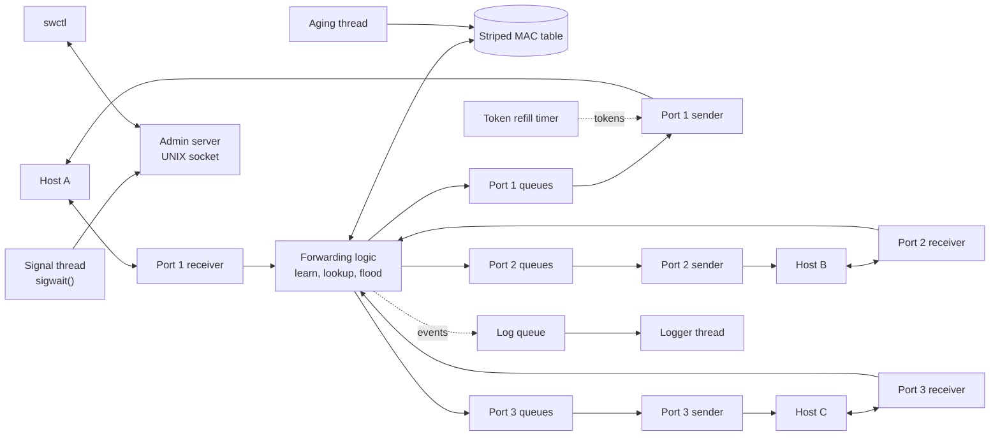

# Virtual Switch

A multithreaded software network switch written in C for the Operating Systems course (Fall 2026).

## Introduction

Virtual Switch is a user-space simulation of a layer-2 Ethernet switch. Each TCP client connects to one logical switch port and sends frames in a fixed format. The switch maintains a MAC address table, forwards each frame to the correct port, and handles the concurrency problems a real switch faces: many ports at once, slow or misbehaving clients, shared frames, and live reconfiguration.

**Motivation.** Real switches are built around hardware, but their core logic (learning, forwarding, flooding, and queueing) is also a strong systems programming exercise. This project combines processes, threads, mutexes, condition variables, semaphores, sockets, signals, and shared memory in one codebase.

## Project Overview

Each port has its own receiver, bounded output queue, and sender. The receiver reads complete frames, learns the source MAC, and asks the forwarding logic which ports should receive the frame. Each output port's sender writes frames independently, so a slow host does not delay the others.

Core behaviour:

1. **Learn:** the source MAC of each incoming frame is recorded against its arrival port.
2. **Forward:** a unicast to a known MAC goes only to that port.
3. **Flood:** broadcasts (`FF:FF:FF:FF:FF:FF`) and unknown destinations go to every eligible port in the same VLAN.
4. **Drop, don't block:** when a port's queue is full, the frame is dropped for that port and counted.
5. **Administer:** a separate `swctl` process changes port state, VLANs, and the MAC table while traffic is flowing.

## Key Features

| Feature | Description |
| --- | --- |
| Wire header | 17-byte header with network-byte-order fields |
| Striped MAC table | Hash table with one lock per bucket |
| Partial I/O handling | Loops over `read()` and `write()` so partial frames are reassembled |
| Bounded per-port queues | Mutex and condition variables, with a sender thread per port |
| Shared broadcast frames | Reference-counted frames shared across queues |
| MAC aging, LRU eviction, port security | Expiry thread, capacity limit, and per-port MAC cap |
| Port admission control | Counting semaphore with `sem_timedwait()` and a `switch full` reply |
| Weighted round-robin QoS | Three priority queues per port with aging against starvation |
| Token-bucket rate limiting | Timer-driven refill and `pthread_cond_timedwait()` |
| VLANs and trunk port | Per-port VLAN isolation, with tags preserved on the trunk |
| Port mirroring | Non-blocking copy of a port's traffic to a sniffer |
| Live reconfiguration | Shutdown, bring-up, VLAN change, and MAC clearing under load |
| `swctl` admin tool | UNIX domain socket control and shared-memory `stats --watch` |
| Signal handling | Dedicated `sigwait()` thread for `SIGINT`, `SIGHUP`, and `SIGUSR1` |
| Asynchronous logging | Logger thread that writes timestamped output off the fast path |

## Architecture

### Thread and data flow



### Components

| File | Responsibility |
| --- | --- |
| `frame.h`, `frame.c` | Header layout, validation, serialization, and deserialization |
| `mac_table.h`, `mac_table.c` | Striped hash table, aging, LRU eviction, and port security |
| `switch.c` | TCP listener, port admission, and switch lifecycle |
| `port.c` | Per-port receiver and sender threads, rate limiting, and scheduling |
| `queue.c` | Bounded queues, priority levels, and reference-counted frame ownership |
| `host.c` | TCP test host that sends and receives frames |
| `swctl.c` | Admin client that talks to the switch over a UNIX domain socket |
| `main.c` | Standalone tests for the header and concurrent MAC table |

## Project Structure

```text
virtual-switch/
├── frame.h          # Wire header definition and API
├── frame.c          # Header serialization and validation
├── mac_table.h      # Striped MAC table API
├── mac_table.c      # Hash table, aging, eviction, port security
├── switch.c         # Listener, admission control, lifecycle
├── port.c           # Port receiver and sender threads
├── queue.c          # Bounded queues and frame reference counting
├── host.c           # Test host client
├── swctl.c          # Admin tool
├── main.c           # Standalone header and MAC table tests
├── Makefile         # Build targets
├── switch.conf      # Sample configuration
├── tests/           # Test scripts and cases
├── report.pdf       # Final report
└── README.md
```

## Technologies Used

| Category | Technology |
| --- | --- |
| Language | C (C11) |
| Compiler | GCC |
| Build | GNU Make |
| Concurrency | POSIX threads, mutexes, condition variables, `sem_timedwait` |
| IPC | TCP sockets, UNIX domain sockets, shared memory with `PTHREAD_PROCESS_SHARED` |
| Signals | POSIX signals with a dedicated `sigwait()` thread |
| Verification | Valgrind (memcheck), GCC ThreadSanitizer (`-fsanitize=thread`) |

## Prerequisites

- Linux with POSIX APIs
- GCC with C11 support
- GNU Make
- POSIX threads (`-pthread`)
- Optional: Valgrind and GCC ThreadSanitizer support

Check your toolchain:

```bash
gcc --version
make --version
valgrind --version
```

## Installation & Setup

```bash
git clone https://github.com/ShajiaSiddiqa/virtual-switch.git
cd virtual-switch
ls
```

No dependencies beyond the standard C library and POSIX threads are required.

## Compilation & Execution

### Compiler flags

The course build uses:

```bash
gcc -std=c11 -Wall -Wextra -Werror -g -O0 -pthread
```

### Build with Make

```bash
make          # build all programs
make clean    # remove binaries and object files
```

### Build and run the header and MAC table test

```bash
gcc -std=c11 -Wall -Wextra -Werror -g -O0 -pthread \
    main.c frame.c mac_table.c -o lab_test
./lab_test
```

### Run the switch

```bash
./switch <tcp_port> <num_ports>
./switch 9000 4
```

### Run a test host

```bash
./host <switch_ip> <tcp_port> <mac>
./host 127.0.0.1 9000 02:00:00:00:00:01
```

### Check with Valgrind and ThreadSanitizer

```bash
valgrind --leak-check=full ./switch 9000 4

gcc -std=c11 -g -O1 -pthread -fsanitize=thread \
    switch.c frame.c mac_table.c port.c queue.c -o switch_tsan
./switch_tsan 9000 4
```

## Usage Guide

### 1. Start the switch

```bash
./switch 9000 4
```

This listens on TCP port `9000` and creates four switch ports.

### 2. Connect two hosts

In two more terminals:

```bash
./host 127.0.0.1 9000 02:00:00:00:00:01
./host 127.0.0.1 9000 02:00:00:00:00:02
```

### 3. Test forwarding

1. Send a frame from `02:00:00:00:00:01` to `02:00:00:00:00:02`. The switch floods it because the destination is unknown.
2. Send a reply from `02:00:00:00:00:02` to `02:00:00:00:00:01`. The switch learns the port of `…:02`.
3. Send again from `…:01` to `…:02`. The frame is now forwarded only to the port of `…:02`.
4. Send to `FF:FF:FF:FF:FF:FF` to test broadcast.

### 4. Administer the switch

`swctl` talks to the running switch over a UNIX domain socket.

| Command | Purpose |
| --- | --- |
| `./swctl show mac` | List learned MAC entries |
| `./swctl show ports` | Show port status and VLAN assignments |
| `./swctl shutdown <port>` | Shut down a port and clean up its workers and queue |
| `./swctl up <port>` | Bring a port back into service |
| `./swctl vlan <port> <vlan>` | Change a port's VLAN |
| `./swctl mirror <port> <sniffer_port>` | Copy a port's traffic to a sniffer port |
| `./swctl clear mac` | Clear learned MAC entries |
| `./swctl stats` | Show per-port frames in, out, dropped, and mirrored |
| `./swctl stats --watch` | Refresh the counters every second |

### 5. Signals

| Signal | Action |
| --- | --- |
| `SIGINT` | Clean shutdown: join threads, close sockets, free memory |
| `SIGHUP` | Reload `switch.conf` without restarting |
| `SIGUSR1` | Dump the MAC table to a file |

```bash
kill -HUP  $(pgrep switch)
kill -USR1 $(pgrep switch)
kill -INT  $(pgrep switch)
```

## Configuration

The switch reads `switch.conf` from the working directory, one `key=value` per line:

```ini
mac_age_seconds=60
mac_table_capacity=256
max_macs_per_port=16
port_wait_ms=2000
queue_capacity=64
rate_frames_per_second=100
default_vlan=1
trunk_port=4
admin_socket=/tmp/virtual-switch.sock
log_file=switch.log
mac_dump_file=mac-table.txt
```

## Wire Protocol

Every frame is a 17-byte header followed by 0–1500 bytes of payload. Multi-byte fields use network byte order (`htons` and `ntohs`).

| Offset | Field | Size | Meaning |
| ---: | --- | ---: | --- |
| 0–1 | `length` | 2 | Payload length, 0–1500 |
| 2–7 | `src` | 6 | Source MAC address |
| 8–13 | `dst` | 6 | Destination MAC (`FF:FF:FF:FF:FF:FF` is broadcast) |
| 14–15 | `vlan` | 2 | VLAN ID, 1–4094 |
| 16 | `priority` | 1 | `0` high, `1` normal, `2` low |
| 17 onward | payload | `length` | Frame data |

TCP is a byte stream, so a single `read()` or `write()` can transfer fewer bytes than requested. The switch loops until each frame is complete.

## Technical Details

### Data structures

- **Frame header:** a fixed 17-byte layout.
- **Striped MAC table:** an array of buckets, each with its own mutex. A MAC hashes to one bucket, so lookups contend only when they hit the same bucket.
- **Port queues:** three bounded FIFOs (high, normal, low) per port, each protected by a mutex and condition variables.
- **Shared frames:** a reference-counted buffer. Each queue holds a reference, and the last sender to finish frees it.

### Concurrency primitives

| Primitive | Used for |
| --- | --- |
| Striped mutexes | MAC table buckets |
| Mutex and condition variables | Port queues and token waits |
| Counting semaphore (`sem_timedwait`) | Port admission with timeout |
| `PTHREAD_PROCESS_SHARED` mutex | Live counters in shared memory for `swctl` |
| `sigwait()` on a dedicated thread | Signal handling |
| Timer thread and `pthread_cond_timedwait` | Token-bucket refill |

### Scheduling

Each sender uses weighted round robin across its three priority queues (for example 5:3:1). Aging prevents low-priority frames from starving.

### Rate limiting

Each port has a token bucket. A timer thread adds tokens at the configured rate, up to the bucket size. A sender with no tokens waits on a condition variable rather than sleeping or spinning.

### Correctness rules

- No busy waiting, and no `sleep()` used for synchronisation.
- Every fallible system call has its return value checked.
- `SIGPIPE` is ignored and `EPIPE` is handled, so a disconnected host does not crash the switch.

## Code Examples

Compile and run the header test:

```bash
gcc -std=c11 -Wall -Wextra -Werror -g -O0 -pthread \
    main.c frame.c mac_table.c -o lab_test && ./lab_test
```

## Testing

Stress scenarios to cover:

- Partial frames
- Slow and frozen clients
- Many simultaneous connections
- Live admin changes
- Signals during traffic

## Future Improvements

- Two-switch trunk over pipes for inter-switch forwarding (bonus)
- Crash supervisor using `fork()` and `waitpid()`, with the MAC table in shared memory (bonus)
- Benchmark comparing global mutex, striped locks, and read-write locks (bonus)
- Structured logging with log levels
- Configuration validation with clear error messages

## Roadmap & Checklist

Grading weight: Tier 1 (core) 50%, Tier 2 (advanced) 35%, report 15%, Tier 3 (bonus) up to 15%.

### Day 1: Get two hosts forwarding

- [ ] **1 · Wire protocol.** Test all header fields, exact wire bytes, and invalid lengths, VLANs, and priorities. Loop on partial reads and writes. Test disconnects mid-header and mid-payload. Ignore `SIGPIPE` and handle `EPIPE`.
- [ ] **4 · MAC table foundation.** Finish `main.c`. Verify lookup hit and miss, concurrent insert and lookup, and a move that updates the port and logs `MAC moved: port X -> port Y`.
- [ ] **2 · Port queues.** Add a bounded output queue with a mutex and condition variables, plus a sender per port. Verify that a frozen receiver fills only its own queue, drops are counted, and forwarding to other ports continues.
- [ ] **5 · Port admission.** Use a counting semaphore and `sem_timedwait()`. Verify that an extra client either acquires a released port or receives `switch full` and disconnects.
- [ ] Build `switch` and `host` with the Makefile. Verify learned unicast, unknown-destination flooding, and broadcast locally.

### Day 2: Finish core and advanced forwarding

- [ ] **3 · Shared broadcast frames.** Queue references to a single frame. Release references on send completion, error, and queue cleanup. Run mixed delivery and drops under Valgrind and ThreadSanitizer.
- [ ] **4 · Complete the MAC table.** One mutex per bucket. Add the aging thread, global capacity with LRU eviction, and the per-port MAC limit that shuts down a violating port. Test aging, eviction, limits, and concurrent learning.
- [ ] **6 · Quality of service.** Three queues per port, weighted round robin (for example 5:3:1), and queue aging. Verify low-priority frames still leave under sustained high-priority traffic.
- [ ] **7 · Rate limiting.** Refill per-port token buckets from a timer thread. Use `pthread_cond_timedwait()` when a sender has no tokens. Check the configured rate under load.
- [ ] **8 · VLANs and trunk.** Enforce VLAN isolation for unicast and flooding. Verify a trunk carries multiple VLANs and preserves their tags.

### Day 3: Integrate live administration

- [ ] **9 · Mirroring.** Copy the selected port's traffic to the sniffer through a non-blocking enqueue. Verify a blocked sniffer does not slow the monitored port.
- [ ] **10 · Live reconfiguration.** Implement shutdown, up, VLAN changes, and MAC clearing during traffic. On shutdown, wake blocked workers, resolve queued frame ownership, join workers, and free resources. Document and follow one lock order.
- [ ] **11 · Admin and stats.** Implement every `swctl` command over the UNIX domain socket. Keep live counters in shared memory guarded by a `PTHREAD_PROCESS_SHARED` mutex. Verify the one-second `--watch` refresh.
- [ ] **12 · Signal handling.** Block handled signals in worker threads and use one `sigwait()` thread. Verify config reload, MAC dump, and clean shutdown with active clients.
- [ ] **13 · Logging.** Use a log queue and a dedicated file writer with timestamps. Verify a MAC move reaches the log and that logging stays off the forwarding path.
- [ ] Record one real bug, the steps that reproduced it, and the fix.

### Day 4: Verify, attempt bonuses, and submit

**Required verification**

- [ ] Run a clean build with the course flags. Check return values of fallible calls. Remove busy waits and sleep-based synchronisation.
- [ ] Run the course forwarding and broadcast scripts. Stress partial frames, slow clients, many connections, live admin changes, and signals during traffic.
- [ ] Run the same scenarios under Valgrind and ThreadSanitizer. Confirm shutdown joins all threads and closes sockets, and that the tools report no memory or race errors.

**Bonus work**

- [ ] **Two-switch trunk.** Connect two switch processes with two pipes, one per direction. Verify same-VLAN forwarding, cross-VLAN isolation, and MAC learning behind each trunk port.
- [ ] **Crash supervisor.** Use `fork()` and `waitpid()` to restart a crashed switch. Keep the MAC table in shared memory and show that entries survive a restart.
- [ ] **Benchmark.** Build a multithreaded load generator. Compare global mutex, striped mutexes, and a read-write lock on the same workload. Add a graph and summarise the setup and results.
- [ ] Rerun affected tests and tool checks after any bonus changes.

### Submission

- [ ] Include all source files and the Makefile. Verify `make` and `make clean` from a clean checkout.
- [ ] Update this README with actual build and run commands, host input syntax, configuration format, and bonus program usage.
- [ ] Write a 2–3 page report with a thread diagram and responsibilities, every lock and the data it protects, the lock acquisition order, and one real bug with its diagnosis and fix.
- [ ] State exactly which Tier 2 and Tier 3 items were completed and tested.