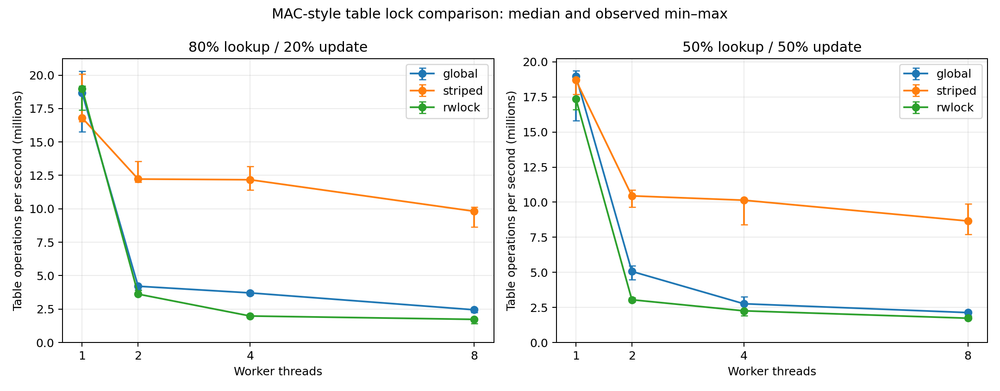

# Virtual Switch — technical report

## 1. Scope and execution model

This project implements a user-space switch in C11. Each TCP connection represents
one logical port. The data plane learns (VLAN, source MAC) mappings, forwards known
unicast and floods group/unknown destinations within VLAN policy. The management
plane uses a UNIX socket and POSIX shared-memory counters. Bonus components add a
two-pipe inter-switch link, supervised process-crash recovery and a lock benchmark.

The main thread accepts connections. Shared workers handle MAC aging, management,
signals and logging. Each active port session executes its receiver and owns a
sender and refill worker. Ignoring sanitizer/runtime helper threads, a fully active
standalone switch therefore has approximately 5 + 3P threads for P active ports.
The supervisor and two-switch launcher are separate parent processes.

## 2. Protocol and ownership

`frame.c` serializes a 17-byte header: payload length (2), source (6), destination
(6), VLAN (2) and priority (1). Length/VLAN are network byte order; payload is bounded
at 1500 bytes. Validation rejects invalid length, VLAN or priority. It does not
assume one TCP read corresponds to one frame.

`io.c` and `frame_io.c` loop over partial transfers and EINTR. EOF between frames
is distinct from EOF inside a header/payload. SIGPIPE is ignored, allowing a failed
write to return an error instead of terminating the process. Sender errors preserve
errno before releasing a frame so cleanup does not overwrite the diagnostic.

`shared_frame.c` gives a newly received frame one atomic reference. An accepted
queue enqueue retains one; rejection retains none. The receiver releases its own
reference after forwarding decisions. Pop transfers a queue-owned reference to the
sender, which releases it after the write attempt. Queue clear/destroy releases
pending references. Relaxed increments and acquire-release decrements separate
reference ownership from payload publication through queue mutexes. Payload/header
are immutable after publication. Flooding within a process shares one allocation.

## 3. Queueing, scheduling and rate control

`frame_queue.c` has three bounded FIFO rings under one per-port queue mutex, with
one condition variable for consumers. Each class has capacity eight. Enqueue never
waits for queue space; it may briefly wait for the queue mutex. Rejected deliveries
are counted. The sender waits while empty and writes outside the queue mutex.
A blocked/frozen client therefore stalls its own sender, not another port's sender.

The weighted schedule is five high, three normal and one low selection per cycle,
skipping empty classes. Queue-head aging uses monotonic enqueue timestamps; an
overdue head can override the weighted selection after 100 ms. FIFO order remains
within each class. This policy prevents scheduling starvation while output makes
progress; it cannot force a frozen physical receiver to consume data.

`rate_limit.c` creates a token bucket per active session. The default rate is 1000
frames/s and burst is ten. A refill worker updates token credit from elapsed
monotonic time at approximately 10 ms intervals. A token-starved sender waits on
pthread_cond_timedwait. Closing wakes both sender and refill waits, and destruction
joins the refill worker. Burst allowance and discrete refill/scheduling affect
short observation windows; the test is not a strict every-window rate proof.

The sender waits for queue availability and tokens before taking transmit_lock and
popping. An administrative queue purge can therefore invalidate availability; a
nonblocking recheck avoids keeping an already popped stale frame across a policy
change. A token may be consumed without a send if the queue was cleared meanwhile.

## 4. MAC learning, aging and security

`mac_table.c` hashes the VLAN and six MAC bytes into sixteen mutex-protected
buckets. Learning refreshes source last_seen, updates last_used and records a move
when a known key arrives on another slot. Successful destination lookup updates
last_used without refreshing source last_seen. Identical MACs in different VLANs
are independent keys.

The capacity mutex serializes structural/accounting changes. Bucket locks protect
individual records and lookups; full-table operations take buckets in ascending
order. The table capacity is 256. LRU eviction uses the smallest last_used sequence.
Aging compares CLOCK_MONOTONIC timestamps, with a default five-second timeout and
one-second sweeps. Per-port security permits four validated MAC/VLAN keys by
default; exceeding the limit terminates that session.

`mac_table_snapshot` creates a bounded management copy. `mac_table_clear` locks all
buckets consistently, frees nodes and resets entry_count. Source lookup/insert,
aging, capacity replacement, disconnect removal and administrative operations must
maintain the count and respect the same ownership rules.

## 5. Admission and live port policy

A counting semaphore represents enabled free host slots. Admission waits with
sem_timedwait for up to two seconds; a timed-out client receives `switch full` and
is closed. The admission mutex coordinates semaphore changes, slot selection and
session joins. It is not a forwarding lock.

Administrative shutdown disables a slot, prevents further enqueue, closes/purges
its output, closes the limiter and interrupts socket I/O. Session/sender/refill
workers are joined before shutdown is acknowledged. A disabled slot does not return
a free admission permit. Up is idempotent and returns exactly one permit for a
previously disabled idle slot. It permits a new connection; it cannot revive the
old TCP session.

Access ingress must carry the port's assigned VLAN before learning is permitted.
Normal egress is restricted to that VLAN. A configurable sole trunk carries all
VLANs without removing the tag. VLAN/trunk changes serialize affected transmitters,
purge queued references and invalidate relevant active MAC mappings.

Mirroring copies accepted ingress and accepted queued egress into a dedicated sniffer queue using the same
shared allocation. A sniffer is excluded from ordinary forwarding and cannot
inject ordinary frames. Cross-VLAN capture is intentional. Its full queue drops
only its own mirrored delivery, so a slow sniffer does not hold the source's
receiver on network I/O. Captures are deduplicated per sniffer for one frame; mirror copies never recurse.
Egress capture means queue acceptance, not a later successful socket write.

## 6. Control, counters, signals and logging

`control.c` reads bounded newline-terminated commands, handles fragmented input,
rejects oversized commands, and writes complete responses. A pollable wake pipe
interrupts control shutdown. `swctl.c` parses commands and distinguishes success
from server errors. Instance-specific socket names prevent test/bonus collisions.

`shm_stats.c` uses shm_open, ftruncate and mmap(MAP_SHARED). The statistics mutex
is PTHREAD_PROCESS_SHARED. Clients map read/write because even taking the mutex
modifies shared memory. `stats --watch` snapshots counters once per second without
using the UNIX control socket. The creating handle remembers its name for cleanup.
Statistics mutexes are not robust crash-recovery objects; supervised restarts
replace disposable statistics, and existing watch mappings must be reattached to
observe a newly created object.

Counters record accepted input frames, successful output writes, implemented
queue/policy drops and accepted mirror queue copies. Mirror acceptance does not
promise a successful socket delivery. Broadcast replication and socket failures
mean the counters are not a simple IN = OUT + DROPPED conservation equation.

Main blocks SIGINT/SIGHUP/SIGUSR1 before creating any worker, including the logger.
A dedicated sigwait thread invokes normal callbacks. SIGINT wakes the main loop
and admission, then coordinated cleanup joins users before destroying resources.
SIGHUP reloads one MAC-age integer from vswitch.conf; it does not reload every
policy. SIGUSR1 snapshots the MAC table and writes a dump file.

`async_logger.c` has a bounded record ring and one writer. Producers use trylock;
contention/full/closing can drop records and increment an atomic counter. The
writer removes a record under its mutex and performs file I/O after unlocking.
Records carry UTC timestamps. Producers stop before logger shutdown drains and
joins the writer. A small dropped-message count is an allowed policy outcome;
submission errors and logger failure are separate conditions.

## 7. Lock order and deadlock reasoning

The following is a partial order, not an instruction to acquire every lock on
every path. Locks omitted by a path are not acquired merely to follow the list.

| Nested path | Order/rule |
| --- | --- |
| Admission/lifecycle | admission mutex → ports mutex; release ports before joining a session |
| Multi-port policy | affected transmit locks ascending → ports mutex |
| Forwarding and MAC changes | ports mutex where used → MAC capacity mutex → bucket locks ascending |
| Supervised publication | MAC capacity → all buckets ascending → shared recovery-store mutex |
| Sender | token wait completes first; transmit → brief queue operation; queue unlocked before write |
| Queue/limiter closure | upper port policy locks may call a leaf queue or limiter operation; those modules never acquire ports/transmit locks |
| Shared counters | snapshot/increment takes only its own mutex; counter code never acquires upper switch locks |
| Logger | producer trylock never waits for a busy logger mutex; writer never takes switch locks |

A lookup releases its bucket before requesting a supervised full checkpoint, so
it does not invert bucket → capacity against capacity → bucket writers. MAC move
logging runs after table locks are released. Aging releases its own control mutex
while sweeping the MAC table. Sender writes hold only that port's transmit mutex,
not the ports mutex, queue mutex or MAC locks. Ordinary session joins occur outside
the ports mutex; a refill-worker join in initialization failure needs only the
limiter's private locks and cannot call back into ports.

These rules explain the absence of cycles in the implemented lock graph. The
stress/TSan results provide additional evidence for exercised paths, not a formal
proof of every interleaving. Administrative latency can include admission timeout
or a current transmit operation; zero-latency reconfiguration is not promised.

## 8. Two-process pipe trunk

The launcher creates A-to-B and B-to-A anonymous data pipes before fork/exec. Each
child keeps its required read/write ends; the parent closes all data descriptors.
Unneeded inherited write ends must close or EOF would not be observed. Each switch
has distinct UNIX/statistics/log names and reserves its final slot for the trunk.

`pipe_link.c` adopts validated FIFO descriptors, uses nonblocking transfers with
poll, preserves transfer offsets on EAGAIN/EINTR, and polls a local cancellation
pipe as well. Stop marks the local endpoint and wakes sender/receiver; descriptor
close occurs after users join. Cancellation pipes are local wake mechanisms,
not extra inter-switch data links. Serialized frames cross processes; reference
counts and heap addresses remain local. Remote MACs are learned on the trunk,
and ingress exclusion prevents reflecting the same flood back over that link.

The fixed physical pipe trunk cannot be hot-reconnected or subjected to incompatible
policy changes. The topology is two switches with one link; spanning tree and
cyclic topologies are not implemented. Existing MAC-security bounds also apply
to remote keys on the trunk.

## 9. Supervisor and crash-consistent MAC recovery

The supervisor creates the MAC store once, then fork/execs workers. waitpid reaps
the exact worker before disposable IPC cleanup and replacement. Normal exit ends
the supervisor; abnormal exit restarts with bounded backoff. Exec/startup exit 127
is not retried. Defaults allow five replacements, 250 ms backoff and five seconds
for graceful stop before SIGKILL and a failure result. Control signals are handled
synchronously and forwarded only to an active unreaped worker.

`mac_store.c` stores plain-value full images, not process-local linked pointers.
It uses a process-shared robust mutex plus two slots. A writer copies an inactive
slot, then publishes its index with a lock-free atomic release store. A dead owner
before publication leaves the old slot selected; after publication it leaves the
new complete slot. EOWNERDEAD recovery validates the selected slot and calls
pthread_mutex_consistent. Corrupt committed data fails closed. This protects
process-crash commits, not power-loss persistence.

The live table's optional checkpoint callback captures and publishes under the
capacity and all-bucket locks. Capture cannot be deferred and overwrite a newer
image out of order. Learning, move, eviction, source refresh, lookup LRU, aging,
validated disconnect removal and clear publish before successful return. Clear
therefore commits before its successful admin reply. Restore validates/allocates
new nodes before installation and preserves source timestamps and LRU metadata.

TCP sessions do not survive exec. Restored records are unvalidated recovery hints:
they remain visible/ageable/evictable, but destination lookup treats them as unknown
until fresh source learning validates their current slot. They do not consume
active port-security allowance. This avoids directing known unicast only to an
unrelated connection that reused an old slot. Unknown flooding remains ordinary
VLAN policy, not confidential delivery. Administrative port policy is not included
in the MAC image and must be reapplied as needed.

Normal unsupervised mode does not enable checkpoint publication. Supervised mode
adds synchronous full-image copies and a serialized checkpoint phase. It prioritizes
bounded crash consistency over maximum lookup throughput. A journal or indexed
shared table could reduce copy cost but needs more complex recovery transactions.
The supervisor manages a standalone switch; combined restart of the pipe pair
is not implemented.

## 10. Benchmark and measured results

The standalone C workload compares a global mutex, sixteen striped mutexes and a
single read-write lock with matching operation choices/seeds. Threads start behind
a readiness gate. Timing ends at the last worker finish timestamp, excluding join
time. Update totals must equal performed writes. The runner warms up, randomizes
policy order, repeats and records raw measurements plus machine metadata.

The final development-machine run used five million operations per thread and
three repeats for one, two, four and eight threads at 80% and 50% reads. The
reported medians at eight threads were:

| Read share | Global mutex, Mops/s | Striped, Mops/s | Read-write lock, Mops/s |
| --- | ---: | ---: | ---: |
| 80% | 2.448 | 9.816 | 1.732 |
| 50% | 2.132 | 8.660 | 1.733 |

Use the complete [generated benchmark report](../results/benchmark/report.md),
raw CSV, summary and metadata alongside this report. The values above are from
terminal output supplied from that run; this documentation update does not
replace or regenerate target-machine results.

Striped locking wins these multi-thread cases, but throughput does not scale
linearly with worker count. Lock/cache contention, scheduling and synchronization
cost are plausible contributors; no hardware profiling established a unique cause.
Read-write locking has overhead and still serializes writers; a read-heavy mix
does not guarantee it will win for short critical sections.

This experiment measures table operations, not switch frames/second. Its read path
does not perform the live table's LRU mutation. Allocation, eviction, aging,
security, global ports_lock, output queues, logging, network I/O and supervised
checkpoints are excluded. Native measurements should not run under Valgrind/TSan.
Three repeats show observed variation, not a statistical confidence guarantee.

## 11. Real bug: stale capacity after MAC aging

An earlier aging implementation freed entries without decrementing entry_count.
That left a logically empty table appearing full; the full-table eviction path
could find no oldest node and reject new learning. The omission was present in
the earlier code reviewed during development. The new mac_aging_count_check fills
the table, forces stale timestamps, expires all entries, asserts zero accounting
and learns a replacement. An isolated generated copy with that earlier omission
reproduces an assertion failure at table.entry_count == 0. The fixed production
code decrements the count under the capacity lock and passes. No fault-injected
source is shipped as production code.

## 12. Compliance update

The required Makefile now builds switch/host/swctl and bonus executables with the
course flags; clean preserves measured results. The host sends and receives,
including partial/coalesced/binary/empty frames, with scripted recv and clean
signal/EOF handling. Mirroring now covers queued egress too. Checked helpers
handle formerly ignored failure-path calls, and the lexical audit guards against
reintroducing unchecked standalone calls in its listed function set. That guard
supplements manual review and is not a proof about arbitrary C semantics.

## 13. Verification evidence and limitations

See [VERIFICATION.md](VERIFICATION.md) for scenario/tool coverage. The development
machine reported clean Tier 1 Memcheck runs after the final recovery changes,
normal VLAN/mirror/admin/logger/pipe integrations, and current-code TSan checks
for ordinary forwarding, port lifecycle, pipe forwarding and supervised recovery.
Store tests inject owner death before/after commit. The live recovery test kills
three actual workers, confirms preserved generations/moves/clear, reconnects in a
different order and verifies safe relearning and final resource cleanup.

Not every possible combination, signal timing, failure injection or hidden test
has been exercised. Public/hidden course harnesses and formatting rules are not
certified by this report. There is no raw NIC/TAP data plane, authenticated host
identity, disk durability, spanning tree, complete policy reload or combined
supervised pipe-pair recovery. The host now accepts send/sendp/recv/quit while asynchronously receiving frames. These boundaries
should accompany the reported results rather than be treated as implemented work.
