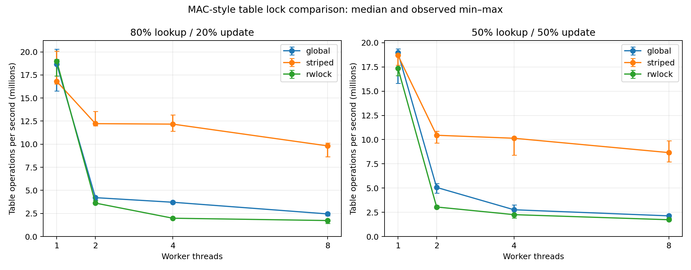

# Lock strategy benchmark

## Scope and method

This is a multithreaded MAC-style table microbenchmark, not a packet-forwarding benchmark. All modes use the same preloaded 256 VLAN/MAC keys, 16 bucket chains, hash function, per-worker random sequences and lookup/update bodies. Only synchronization differs: one global mutex, 16 striped mutexes, or one process-private read-write lock.

Lookup reads a port. Update increments a protected port value and update counter. All keys are hits. Entries are preallocated and stable; the timed region excludes allocation, expiration, eviction, logging, networking and production ports_lock. Lookup does not update LRU or aging; the production switch lookup updates LRU, so this read-write-lock result is not a drop-in performance claim for the current MAC table.

Each worker executes 5,000,000 operations. There are 3 measured repeats per combination, with separate warmup runs and randomized policy order. Thread creation is excluded; coordinated wakeup and workload execution are included. Total work increases with thread count, so the graph compares throughput rather than fixed-job completion time.

Hot-key selection: 0% of requests are forced to key zero; remaining selections are uniform. Every run verifies total stored updates equals total worker write operations. Checksums need not match between modes because concurrent read interleavings differ.

## Results

Error bars show observed minimum–maximum, not confidence intervals.

| Lookup share | Threads | Global Mops/s | Striped Mops/s | RW-lock Mops/s |
|---|---:|---:|---:|---:|
| 80% | 1 | 18.666 | 16.805 | 18.992 |
| 80% | 2 | 4.210 | 12.225 | 3.621 |
| 80% | 4 | 3.712 | 12.175 | 1.983 |
| 80% | 8 | 2.448 | 9.816 | 1.732 |
| 50% | 1 | 18.986 | 18.703 | 17.373 |
| 50% | 2 | 5.067 | 10.450 | 3.047 |
| 50% | 4 | 2.762 | 10.141 | 2.257 |
| 50% | 8 | 2.132 | 8.660 | 1.733 |

## Interpretation

At 8 threads and 80% lookups, the largest measured median was **striped**, 9.816 Mops/s. This observation applies to this machine and workload.
At 8 threads and 50% lookups, the largest measured median was **striped**, 8.660 Mops/s. This observation applies to this machine and workload.

Striping permits operations in different buckets to proceed concurrently. A global mutex serializes all operations. A read-write lock permits concurrent read-only lookups but serializes writers; bookkeeping, reader/writer fairness and write frequency can make it slower than a mutex. There is no assumed universal winner.

## Limitations and reproducibility

0 of 72 timed runs lasted under 0.1 seconds. Increase --ops if many runs are short. Repeat on an otherwise idle target machine. CPU quotas, affinity, oversubscription, frequency changes, cache effects and false sharing can affect results. No CPU pinning or real-time scheduling is imposed. Report raw variability rather than hiding outliers.

Run optimized binaries for timing. Use Valgrind/ThreadSanitizer separately for correctness; instrumented throughput is not comparable to normal optimized performance.

Raw trials: raw.csv. Aggregates: summary.csv. Platform/compiler/settings: metadata.json. The compile command in metadata is the recommended command, not proof of binary provenance.
